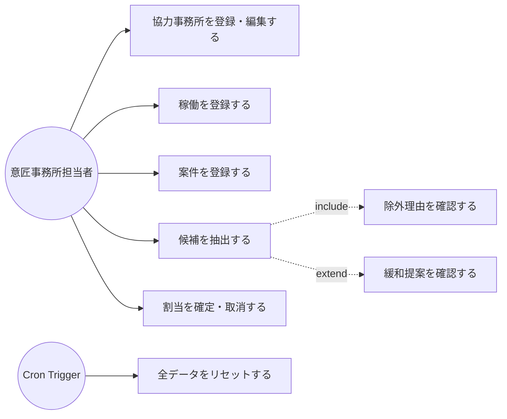
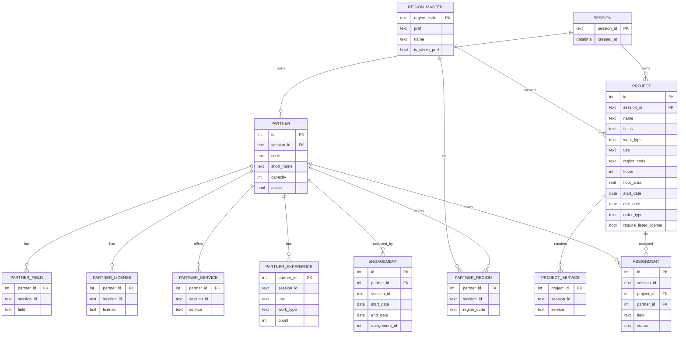
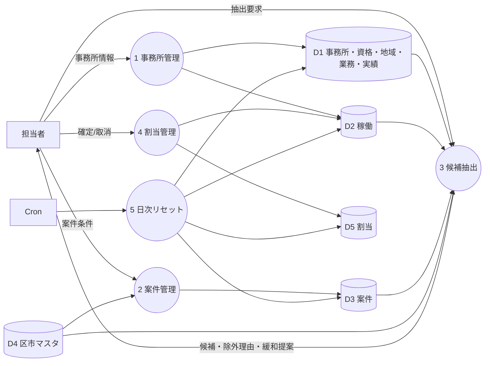
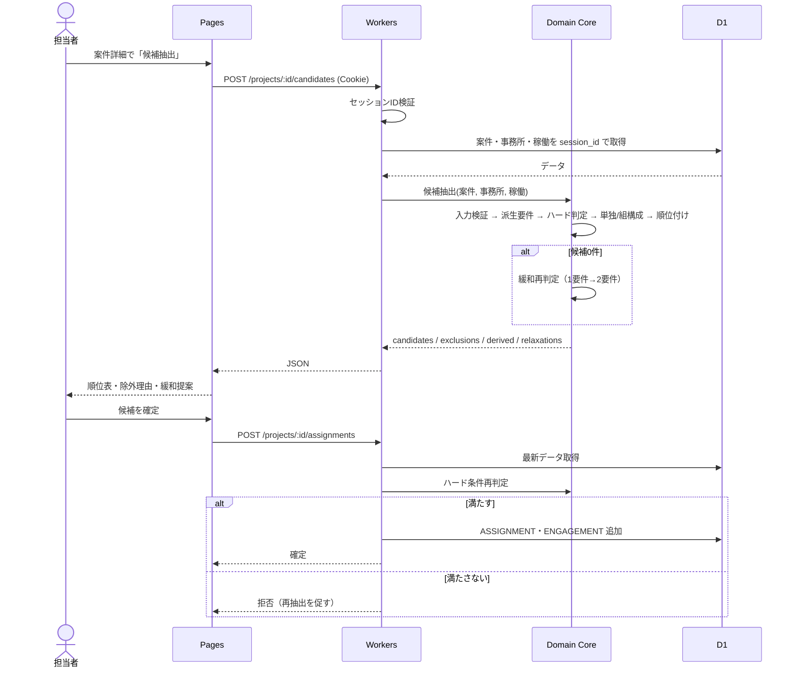
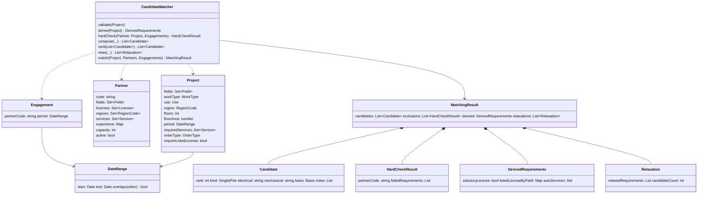
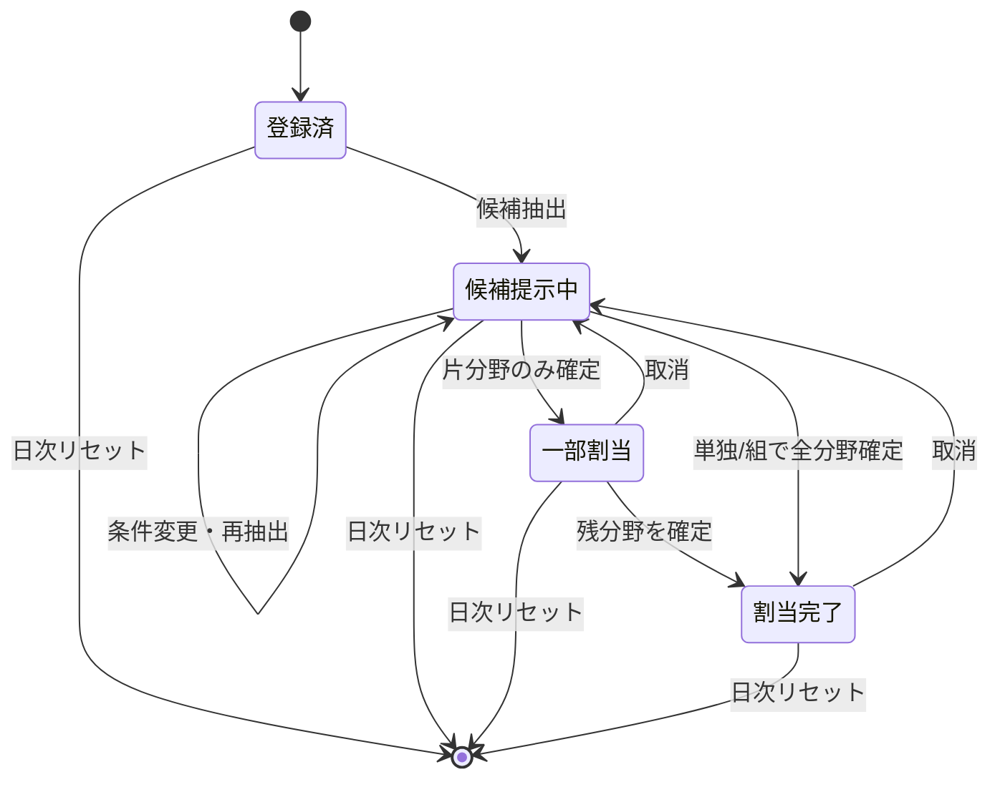
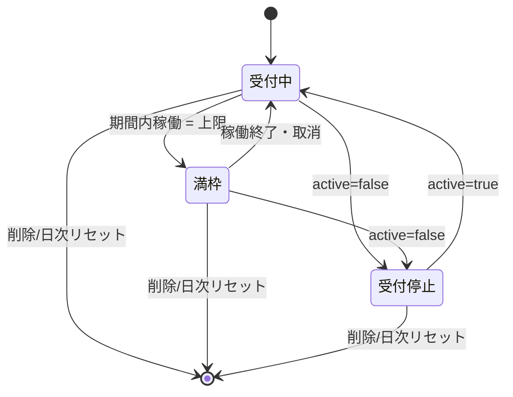

# mep-partner-pool-demo 仕様書（デモ版）

## 1. 概要

| 項目 | 内容 |
|---|---|
| リポジトリ名 | `mep-partner-pool-demo` |
| 製品名（仮） | 設備協力者プール |
| エディション | デモ版（アイデアの視覚化） |
| プラットフォーム | ウェブ（Cloudflare Workers / Pages ＋ D1 によるサーバーレス簡略構成） |
| 想定利用者 | 官公庁案件を主とする意匠設計事務所の担当者 |

### 1.1 解決する課題

意匠設計事務所が、官公庁案件ごとに電気設備・機械設備の協力設計者を都度探す運用をやめるための仕組みです。設備設計事務所をあらかじめ「プール」として登録しておきます。案件の条件を入力すると、プールの中から条件を満たす候補（単独、または電気＋機械の組）を提示し、除外した事務所にはその理由を付けます。

### 1.2 プラットフォーム選定理由

- 成果物を直接操作するのは人間（意匠事務所の担当者）なので、ターゲットは人間向けです。
- 案件条件の入力に応じて出力（候補）が変わり、データの登録・保存も必要です。そのため電子書籍・動画は選べず、ウェブを選定します。
- 処理はCRUDと決定的な条件判定・順位付けのみで、AI・解析・画像加工などの重い処理を伴いません。このため、デモ版の簡略構成（Cloudflare一本化）を採用します。
- 候補の絞り込みは数値比較・期間重複・閾値判定であり、計数・日付比較を含みます。このため分類器（Jev）は用いず、すべてコードによる決定的判定とします。

### 1.3 デモ版の範囲

| 含む | 含まない |
|---|---|
| 協力事務所の登録・編集・削除 | ユーザー認証・認可 |
| 案件の登録と候補抽出（単独・組） | 協力事務所への打診・連絡の送信 |
| 除外理由と緩和提案の表示 | メール・電話番号・担当者氏名の保持 |
| 稼働（期間ごとの引受件数）の管理 | 外部API・AIによる推薦 |
| サンプルデータの初期投入 | デザイン作り込み・利用測定・保守・監視 |

## 2. 構成・制約

### 2.1 技術構成

| 層 | 採用 |
|---|---|
| フロント | Cloudflare Pages（静的UI、既定スタイル） |
| API | Cloudflare Workers |
| DB | Cloudflare D1（SQLite互換） |
| 定期処理 | Workers Cron Triggers（JST 03:00 = UTC 18:00 に全データリセット） |

```text
src/
  frontend/   … Pages（GUI層、Human Interface）
  backend/    … Workers（HTTPアダプタ）
  core/       … Domain Core（候補抽出・判定ロジック。GUI/HTTPに非依存）
```

### 2.2 デモ版制約の適用

- 外部API・APIキーは使いません。
- 認証は持ちません。Cookieで発行するセッションIDを全テーブルのオーナーキーとし、他セッションのデータは参照・操作できません。
- Bot対策はハニーポット方式です。非表示の入力欄に値が入った送信は破棄します。
- DBは毎日JST 03:00に全件削除します。新しいセッションの初回アクセス時には、サンプルデータ（架空の事務所10件・案件3件）を投入します。
- 実装は1 issueのワンショットで行います。

### 2.3 個人情報の扱い

- 協力事務所は「事務所コード」と「表示用略称」のみで識別します。氏名、メールアドレス、電話番号、住所は保持しません。
- 略称は自由入力ですが、個人名の入力を避けるよう入力欄に注記します。
- 連絡手段は「平日電話対応可否」という可否フラグとしてのみ持ちます。

## 3. 機能要件

| ID | 機能 | 概要 |
|---|---|---|
| F-01 | 協力事務所の登録 | 対応分野・資格・用途別実績・対応地域・対応可能業務・引受上限を登録する |
| F-02 | 協力事務所の一覧・編集・削除 | 自セッションのデータのみ対象 |
| F-03 | 稼働登録 | 事務所ごとに、引受中案件の期間を登録する |
| F-04 | 案件登録 | 分野・種別・用途・地域・規模・期間・必要対応・発注形態を登録する |
| F-05 | 候補抽出 | 案件条件から候補（単独・組）を順位付きで出力する |
| F-06 | 除外理由表示 | 全事務所について、除外された要件名を列挙する |
| F-07 | 緩和提案 | 候補が0件のとき、最少の要件緩和で候補が現れる条件を提示する |
| F-08 | 割当確定 | 候補を案件に割り当て、稼働に反映する |
| F-09 | 日次リセット | JST 03:00 に全データを消去する |

## 4. データ定義

### 4.1 協力事務所（Partner）

| 項目 | 型 | 内容 |
|---|---|---|
| fields | 集合 | `電気` / `機械`（1つ以上） |
| licenses | 集合 | `設備設計一級建築士` / `建築設備士` / `1級電気工事施工管理技士` / `1級管工事施工管理技士` / `一級建築士` |
| experience | 用途×種別→件数 | 用途：`教育施設` `公営住宅` `公共施設`、種別：`新築` `改修` |
| regions | 集合 | 東京都の区市、神奈川県の市。`東京都全域` `神奈川県全域` の一括指定も可 |
| services | 集合 | `役所打合せ` `定例会出席` `現地調査` `平日電話対応` `納品検査出席` `積算` |
| capacity | 整数 | 同時に引き受けられる案件数の上限（0以上） |
| active | 真偽 | 受付停止中は抽出対象外 |

### 4.2 案件（Project）

| 項目 | 型 | 内容 |
|---|---|---|
| required_fields | 集合 | `電気` / `機械`（1つ以上） |
| work_type | 列挙 | `新築` / `改修` |
| use | 列挙 | `教育施設` / `公営住宅` / `公共施設` |
| region | 列挙 | 区市単位 |
| floors / floor_area | 整数 / 数値 | 階数・延床面積（㎡） |
| period | 日付区間 | 業務開始日〜納期（両端含む） |
| required_services | 集合 | 必要な対応業務 |
| order_type | 列挙 | `入札` / `プロポーザル` |
| require_listed_license | 真偽 | 実施体制に有資格の担当技術者を記載する必要があるか |

## 5. 候補抽出ロジック（F-05〜F-07）

ロジックは `core` に置く純粋関数「候補抽出（案件, 事務所一覧, 稼働一覧）→ 結果」として定義し、DB・HTTP・GUIに依存させません。

### 5.1 入力検証

1. 必須項目の欠落、開始日 > 納期、延床面積・階数が0以下、必要分野が空の場合は、抽出を行わずに検証エラーを返します。
2. 案件の地域が区市マスタに存在しない場合も、検証エラーとします。

### 5.2 派生要件の算出

1. **法定資格要件：** 階数が3以上かつ延床面積が5,000㎡を超える案件は、「設備設計一級建築士」の関与を必須要件とします。5,000㎡ちょうどは対象外です。
2. **実施体制要件：** `require_listed_license` が真の場合、分野ごとに次のいずれかの保有を必須とします。
   - 電気：建築設備士、設備設計一級建築士、1級電気工事施工管理技士のいずれか
   - 機械：建築設備士、設備設計一級建築士、1級管工事施工管理技士のいずれか
3. **改修補完：** 種別が `改修` の場合は、必要対応に `現地調査` を自動で加えます。画面上では自動追加であることを明示します。

### 5.3 事務所単位の必須判定（ハード条件）

各事務所について以下を判定し、満たさない要件名をすべて除外理由として記録します（最初の不一致で打ち切りません）。

| 判定 | 内容 |
|---|---|
| 受付状態 | `active` が偽なら除外 |
| 地域 | 案件の区市が `regions` に含まれる（全域指定を含む） |
| 対応業務 | `required_services` が `services` にすべて含まれる |
| 稼働 | 案件期間と1日でも重なる引受中案件の数が `capacity` 未満 |
| 分野 | `required_fields` と `fields` の共通部分が空でない |

稼働の重なりは、日付区間の両端を含めて判定します（前案件の納期と新案件の開始日が同日なら重複とみなします）。

### 5.4 単独候補と組候補の構成

1. **単独候補：** ハード条件を満たし、かつ `fields` が `required_fields` をすべて含む事務所です。法定資格要件・実施体制要件も単独で満たす必要があります。
2. **組候補：** 電気と機械の両方が必要な案件では、ハード条件を満たす電気担当と機械担当の組合せも候補にします。
   - 同一事務所の重複は組にしません（その事務所は単独候補として扱います）。
   - 実施体制要件は分野ごとに担当事務所が満たせばよいものとします。
   - 法定資格要件（設備設計一級建築士）は、組のどちらか一方が満たせば成立します。
   - 組の候補数は上位20組までとします。
3. 単独候補・組候補は同じ順位表に並べ、種別（単独／組）を明示します。

### 5.5 順位付け（決定的）

候補ごとに以下の順で比較し、上位を優先します。同値の場合は次の項目で比較します。

1. 当該用途×種別の実績件数（組は2社の小さい方。両分野を同水準でまかなえることを重視するため）
2. 当該用途の実績件数（種別を問わない合計。組は小さい方）
3. 稼働余裕（`capacity` − 期間重複件数。組は小さい方）
4. 単独候補を組候補より優先（窓口が1つで済むため）
5. 事務所コードの昇順（組は電気担当→機械担当の順で比較）

実績が0件の事務所も、ハード条件を満たせば候補に含めます。その場合は「実績なし」の注記を付けます。

### 5.6 候補0件時の緩和提案（F-07）

1. 候補が0件の場合、緩和対象の要件（地域、個別の対応業務、稼働）を1つずつ外して再判定し、候補が1件以上現れる要件を列挙します。
2. 法定資格要件と分野は緩和対象にしません。これらを満たす事務所がいない場合は、「プールに該当資格・分野の事務所が不足」と表示します。
3. 1要件の緩和で候補が現れない場合は、2要件の組合せまで試行します。それでも現れなければ、プール不足として扱います。
4. 緩和提案は提案にとどめ、案件条件を自動では変更しません。

### 5.7 出力

| 出力 | 内容 |
|---|---|
| candidates | 順位、種別（単独／組）、事務所コード（組は分野別）、根拠（実績件数・稼働余裕・充足資格）、注記 |
| exclusions | 全事務所について、除外理由の要件名リスト（候補になった事務所は空） |
| derived | 自動適用した派生要件（法定資格・実施体制・改修補完）の一覧 |
| relaxations | 候補0件時のみ。緩和すると候補が現れる要件と、その候補数 |

### 5.8 割当確定（F-08）

1. 確定時には、確定時点のデータでハード条件を再判定します。満たさなくなっていれば確定を拒否し、再抽出を促します。
2. 確定した事務所には、案件期間で稼働を1件追加します。組の場合は2社それぞれに追加します。
3. 確定の取消しで、稼働を元に戻します。

## 6. 画面

| 画面 | 内容 |
|---|---|
| 事務所一覧 | プールの一覧。分野・資格・地域で絞り込み |
| 事務所編集 | F-01・F-03 の入力 |
| 案件一覧 | 登録案件と割当状況 |
| 案件詳細・候補 | 案件条件、派生要件、候補順位表、除外理由（折りたたみ）、緩和提案、確定ボタン |

## 7. ユースケース図



## 8. ER図



- `REGION_MASTER` 以外の全テーブルは `session_id` を持ちます。すべての読み書きで `session_id` 一致を条件とします。
- `ENGAGEMENT.assignment_id` が空の行は、手動登録された他案件の稼働を表します。

## 9. DFD（レベル1）



## 10. シーケンス図（候補抽出と確定）



## 11. クラス図（Domain Core）



## 12. 状態遷移図

### 12.1 案件



### 12.2 協力事務所



「満枠」は、案件期間ごとに算出する派生状態です。期間によって受付中にも満枠にもなり得ます。

## 13. 設計原則

- **全件判定：** ハード条件は不一致で打ち切らず、全要件を判定します。除外理由の網羅性を保つためです。
- **境界の明示：** 法定資格要件は「3階以上かつ5,000㎡超」とし、5,000㎡ちょうどを含めません。稼働の期間重複は両端を含めて判定します。
- **組の要件分担：** 実施体制要件は分野ごとに担当事務所が満たし、法定資格要件は組のいずれか一方が満たせば成立するものとします。
- **決定性：** 同じ入力には常に同じ順位を返します。最終の比較キーは事務所コードです。
- **組の評価は弱い方基準：** 組の実績・稼働余裕は2社の小さい方で評価し、片方の強さで弱点を隠しません。
- **自動補完の可視化：** 改修案件に現地調査を加えるなどの自動適用は、すべて `derived` として表示します。
- **緩和は提案のみ：** 案件条件を自動では変更しません。法定資格と分野は緩和対象外とします。
- **確定時の再判定：** 抽出から確定までの間に起きたデータ変更による二重割当を防ぎます。
- **所有者分離：** すべてのクエリに `session_id` 条件を付け、他セッションのデータへの到達経路を持ちません。

## 14. マスタデータ件数

| マスタ | 件数 |
|---|---|
| 区市マスタ | 東京都 49（23区＋26市）＋ 神奈川県 19市 ＋ 全域指定 2 ＝ 70 |
| 分野 | 2 |
| 資格 | 5 |
| 用途 | 3 |
| 種別 | 2 |
| 対応業務 | 6 |
| 発注形態 | 2 |
| サンプル事務所（初期投入） | 10 |
| サンプル案件（初期投入） | 3 |

## 15. 運用

- 日次リセット：JST 03:00。全テーブルを削除し、区市マスタのみ保持します。
- サンプルデータは架空の事務所コード・略称のみで構成し、実在の事業者名は使いません。
- 測定・保守・監視は行いません（デモ版）。
